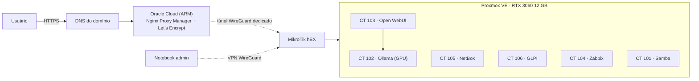
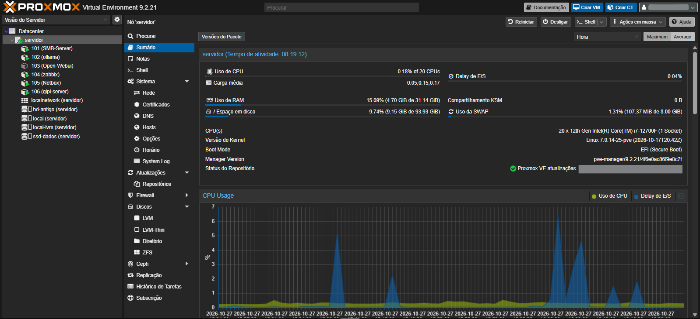
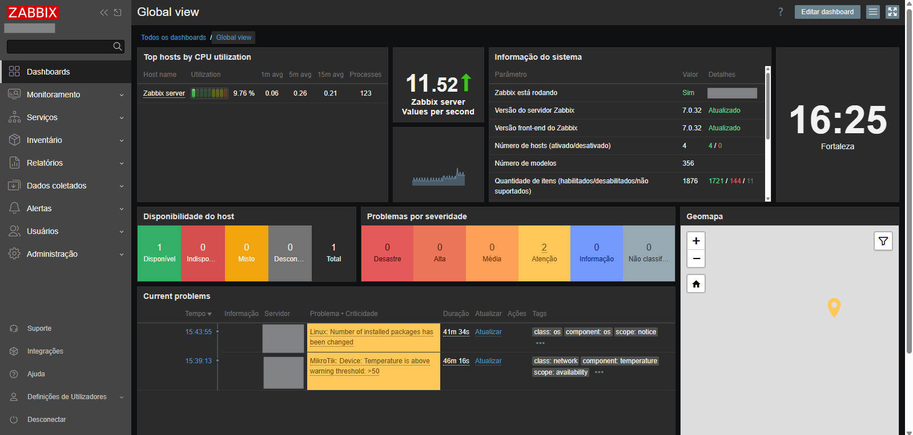
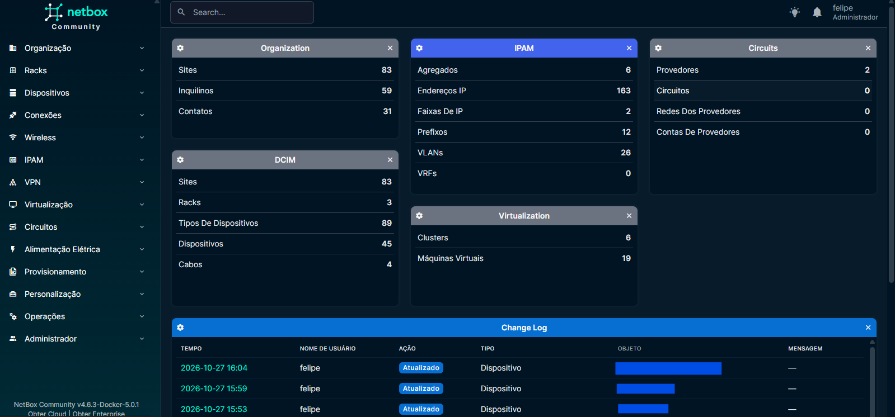
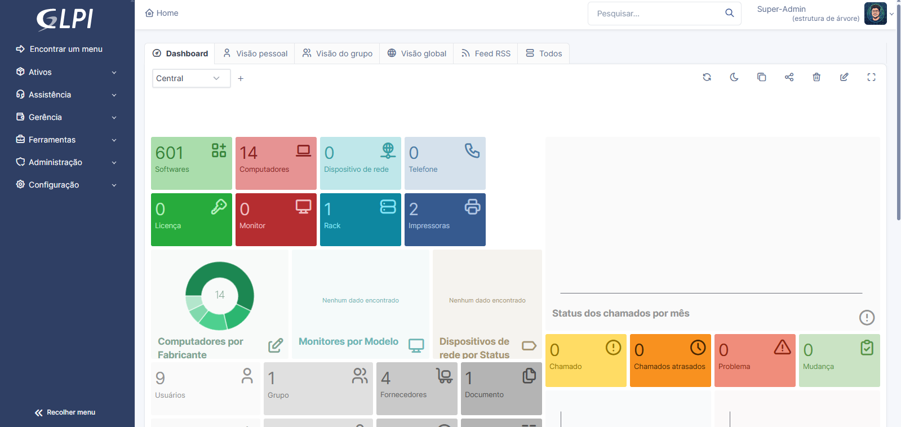

# homelab-infra

Homelab com **IA local na GPU**, serviços de NOC (IPAM, chamados e monitoramento) e **publicação segura na internet** sem abrir portas na rede de casa.

Montado em um PC comum com Proxmox VE, uma RTX 3060 e uma instância gratuita da Oracle Cloud como porta de entrada pública.

> Este repositório guarda configurações de referência, scripts e a documentação das decisões. Nenhum segredo é versionado: senhas, chaves e tokens ficam fora daqui (veja [Segurança](docs/seguranca.md)).

## Arquitetura

Detalhes em [docs/arquitetura.md](docs/arquitetura.md).

## O que tem aqui

| Pasta | Conteúdo |
|---|---|
| [`proxmox/host`](proxmox/host) | Rede com VLANs, IPv6 desativado, driver NVIDIA com Secure Boot, SSD de dados e [backup](proxmox/host/backup) |
| [`proxmox/lxc`](proxmox/lxc) | Configurações de referência dos containers |
| [`proxmox/firewall`](proxmox/firewall) | IPSets e regras do firewall do Proxmox |
| [`servicos/`](servicos) | Ollama, Open WebUI, Samba, NetBox, GLPI, Zabbix a sincronização NetBox → Zabbix e a integração Zabbix → GLPI |
| [`oracle/`](oracle) | Proxy público: Nginx Proxy Manager, WireGuard, firewall da instância |
| [`mikrotik/`](mikrotik) | Ponta local do túnel e regras de firewall |
| [`docs/`](docs) | Arquitetura, segurança, lições aprendidas e roadmap |

## Destaques

- **IA 100% local:** Ollama em LXC não privilegiado com passthrough da GPU; modelos de 8–12B rodando inteiros na VRAM.
- **Secure Boot mantido:** módulo NVIDIA assinado com chave MOK via DKMS, reassinado a cada atualização de kernel.
- **Publicação sem portas abertas:** o roteador inicia o túnel até a nuvem; o proxy só alcança o serviço publicado.
- **Firewall por padrão fechado** em todos os containers, com grupos de acesso separados para administração e proxy.
- **Containers restaurados endurecidos:** serviços vindos de um servidor antigo convertidos de privilegiados para não privilegiados.

## Stack

Proxmox VE 9 · Debian 13 · LXC · Docker · Ollama · Open WebUI · NetBox · GLPI · Zabbix · Samba · WireGuard · Nginx Proxy Manager · Let's Encrypt · Oracle Cloud (ARM) · MikroTik RouterOS 7

## Status

| Etapa | Status |
|---|---|
| Host Proxmox, VLANs e hardening | ✅ |
| GPU com Secure Boot | ✅ |
| Ollama + Open WebUI | ✅ |
| Proxy na Oracle + túnel WireGuard + HTTPS | ✅ |
| NetBox e GLPI restaurados | ✅ |
| Zabbix 7.0 LTS | ✅ |
| Sincronização NetBox → Zabbix | ✅ |
| Integração Zabbix → GLPI | ✅ |
| Bancos em SSD dedicado | ✅ |
| NOC publicado no proxy (só IPs da empresa + MFA) | ✅ |
| SNMP por equipamento via NetBox (porta/community) | ✅ |
| Backbone completo no monitoramento | 🔄 |
| Agente de IA (OpenClaw) em VM isolada | ⏳ |

Roadmap por sistema (Proxmox, Zabbix, NetBox, GLPI, integrações, proxy e IA) em [docs/roadmap.md](docs/roadmap.md).

## Telas

| Proxmox | Zabbix |
|---|---|
|  |  |
| **NetBox** | **GLPI** |
|  |  |

> Capturas com nomes de hosts, IPs e objetos ocultados.

## Como usar estes arquivos

Os arquivos `*.example` são modelos: copie sem o sufixo e troque os valores entre `<...>`. Os comandos assumem Proxmox VE 9 / Debian 13.

## Licença

[MIT](LICENSE)
