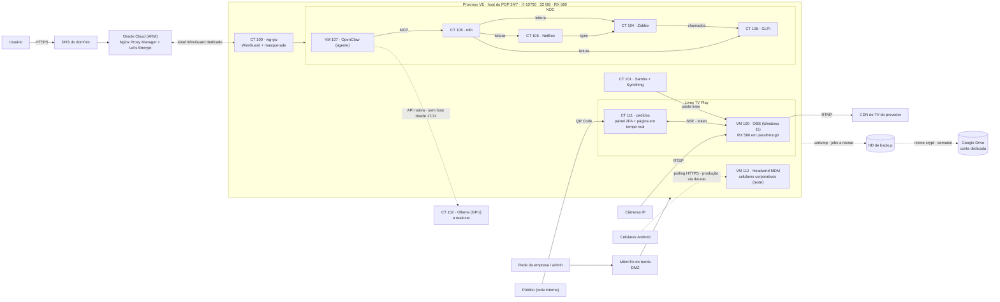
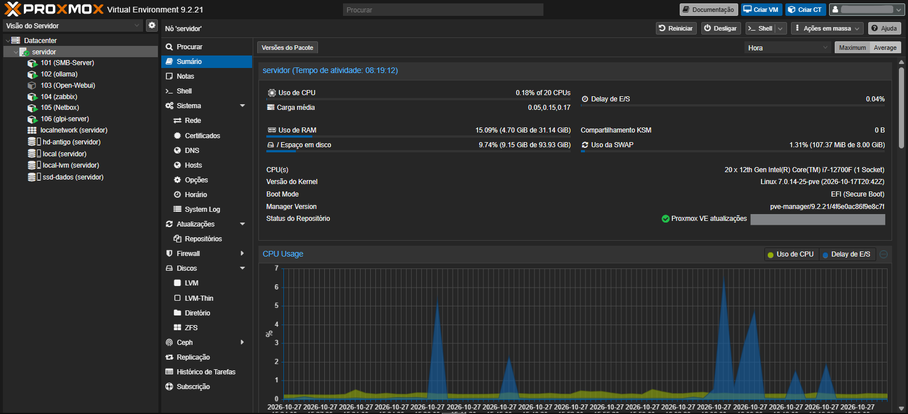
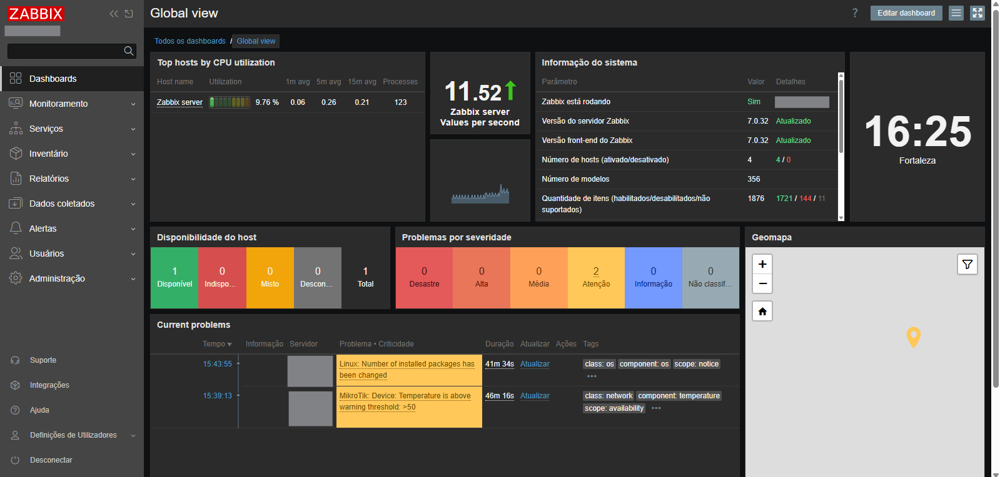
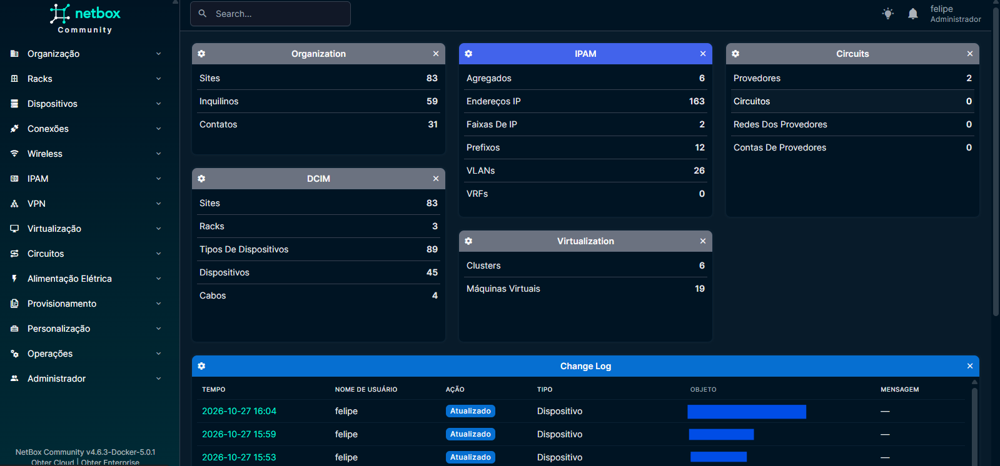
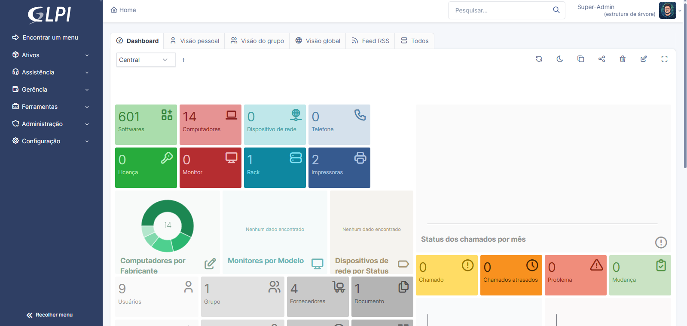

# homelab-infra

Homelab com **IA local na GPU**, serviços de NOC (IPAM, chamados e monitoramento) e **publicação segura na internet** sem abrir portas na rede de casa.

Começou num PC comum com Proxmox VE e uma RTX 3060; desde 15/11/2026 roda num host 24/7 no POP do provedor (i7-10700, 32 GB, RX 580), com uma instância gratuita da Oracle Cloud como porta de entrada pública. Também transmite as lives da TV do provedor (OBS) com interação do público por QR Code e, em teste, gerencia os celulares corporativos (MDM).

> Este repositório guarda configurações de referência, scripts e a documentação das decisões. Nenhum segredo é versionado: senhas, chaves e tokens ficam fora daqui (veja [Segurança](docs/seguranca.md)).

## Arquitetura

Detalhes em [docs/arquitetura.md](docs/arquitetura.md).

## O que tem aqui

| Pasta | Conteúdo |
|---|---|
| [`proxmox/host`](proxmox/host) | Rede com VLANs, IPv6 desativado, driver NVIDIA com Secure Boot, passthrough de GPU AMD, SSD de dados e [backup](proxmox/host/backup) |
| [`proxmox/lxc`](proxmox/lxc) | Configurações de referência dos containers |
| [`proxmox/firewall`](proxmox/firewall) | IPSets e regras do firewall do Proxmox |
| [`servicos/`](servicos) | Ollama, Samba, OBS (VM das lives), [pedidos](servicos/pedidos) (QR Code + painel admin), [MDM](servicos/mdm) (celulares corporativos), NetBox, GLPI, Zabbix, OpenClaw, n8n, Discord, a sincronização NetBox → Zabbix e a integração Zabbix → GLPI |
| [`oracle/`](oracle) | Proxy público: Nginx Proxy Manager, WireGuard, firewall da instância |
| [`mikrotik/`](mikrotik) | Ponta local do túnel e regras de firewall |
| [`docs/`](docs) | Arquitetura, segurança, lições aprendidas e roadmap |

## Destaques

- **IA 100% local:** Ollama em LXC não privilegiado com passthrough da GPU; modelos de 8–12B rodando inteiros na VRAM.
- **Secure Boot mantido:** módulo NVIDIA assinado com chave MOK via DKMS, reassinado a cada atualização de kernel.
- **Publicação sem portas abertas:** o roteador inicia o túnel até a nuvem; o proxy só alcança o serviço publicado.
- **Firewall por padrão fechado** em todos os containers, com grupos de acesso separados para administração e proxy.
- **Containers restaurados endurecidos:** serviços vindos de um servidor antigo convertidos de privilegiados para não privilegiados.

## Stack

Proxmox VE 9 · Debian 13 · LXC · Docker · Ollama · OpenClaw · n8n · OBS Studio · Streamlink · Headwind MDM · Tomcat · PostgreSQL · Open WebUI · NetBox · GLPI · Zabbix · Samba · WireGuard · Nginx Proxy Manager · Let's Encrypt · Oracle Cloud (ARM) · MikroTik RouterOS 7

## Status

| Etapa | Status |
|---|---|
| Host Proxmox, VLANs e hardening | ✅ |
| GPU com Secure Boot | ✅ |
| Ollama + Open WebUI | ✅ |
| Proxy na Oracle + túnel WireGuard + HTTPS | ✅ |
| NetBox e GLPI restaurados | ✅ |
| Zabbix 7.0 LTS | ✅ |
| Sincronização NetBox → Zabbix | ✅ |
| Integração Zabbix → GLPI | ✅ |
| Bancos em SSD dedicado | ✅ |
| NOC publicado no proxy (só IPs da empresa + MFA) | ✅ |
| SNMP por equipamento via NetBox (porta/community) | ✅ |
| Backbone completo no monitoramento | 🔄 |
| Agente de IA (OpenClaw) em VM isolada, com Zabbix, NetBox e GLPI somente leitura | ✅ |
| Backup local + cópia criptografada fora do PC | ✅ |
| n8n orquestrando o resumo do NOC para o agente (MCP, tokens próprios somente leitura) | ✅ |
| Checagem semanal de versão/avisos do n8n no Zabbix | ✅ |
| Segundo host Proxmox no POP (24/7) com os CTs/VMs migrados e túnel WireGuard em CT próprio | ✅ |
| Jobs de backup recriados no host do POP | 🔄 |
| VM do OBS (Windows 11, RX 580 em passthrough) transmitindo 24/7 para o CDN de TV | ✅ |
| Lives: grade automática, música por período, tela "Sem Sinal" e retransmissão por link | ✅ |
| Pedidos de música por QR, painel admin com 2FA e página em tempo real ([CT 111](servicos/pedidos/README.md)) | ✅ |
| Recados moderados e enquetes nas lives (F4) | ⏳ |
| MDM dos celulares corporativos (Headwind, [VM 112](servicos/mdm/README.md)) — teste com 1 aparelho | 🔄 |
| IA local de volta (host antigo formatado em 17/11; agente sem LLM) | ⏳ |
| Grafana para o NOC | ⏳ |

Legenda: ✅ concluído · 🔄 em andamento · ⏳ pendente. Atualizado em 21/11/2026.

Roadmap por sistema (Proxmox, Zabbix, NetBox, GLPI, integrações, proxy, IA, n8n e lives) em [docs/roadmap.md](docs/roadmap.md).

### Próximos passos

1. MDM: testar as restrições no aparelho de teste uma a uma; conta nominal + 2FA no painel; depois produção (domínio, certificado, allowlist no Nginx, dst-nat).
2. Lives: usuário visualizador do marketing no painel; validar a saída automática do Jornal, a Missa de domingo e o failover das câmeras; depois recados e enquetes (F4).
3. Host do POP: persistir a regra `DOCKER-USER` do GLPI e recriar os jobs de backup (incluindo VM 109, CT 111 e VM 112).
4. Definir onde o LLM do agente volta a rodar.
5. Zabbix em escala (~450 dispositivos): dependências/severidades, filtro de interfaces no LLD e importação CSV no NetBox.
6. Grafana; depois Consolidação (testes de segurança e de uso).

## Telas

| Proxmox | Zabbix |
|---|---|
|  |  |
| **NetBox** | **GLPI** |
|  |  |

> Capturas com nomes de hosts, IPs e objetos ocultados.

## Como usar estes arquivos

Os arquivos `*.example` são modelos: copie sem o sufixo e troque os valores entre `<...>`. Os comandos assumem Proxmox VE 9 / Debian 13.

## Licença

[MIT](LICENSE)
