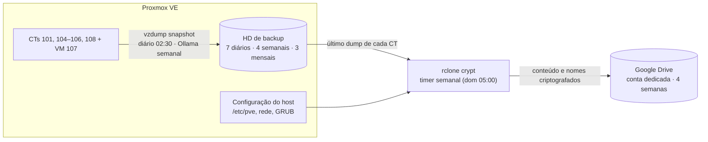

# Arquitetura

## Endereçamento

| Rede | Faixa | Uso |
|---|---|---|
| DMZ do roteador de borda | `/30` sem VLAN, IP privado mascarado pelo NAT | Host atual do POP (desde 15/11/2026) |
| VLAN 1050 — gerência | `10.0.0.0/28` | Gerência (host antigo; mesmo padrão no host novo) |
| VLAN 1010 — serviços | `10.0.10.0/24` (gw `10.0.10.1`) | Containers e VMs |
| VPN de administração | `10.0.212.0/24` | Notebook e acessos administrativos |
| Túnel do proxy | `10.0.213.x` | Oracle ↔ CT 100 `wg-gw` (antes: MikroTik, desfeito em 15/11) |
| VCN da Oracle | `10.0.20.0/24` | Sub-rede da instância na nuvem (reservada) |

## Containers

| ID | Serviço | Tipo | Disco | Observação |
|---|---|---|---|---|
| 100 | wg-gw | LXC não privilegiado | SSD local | Túnel WireGuard com o proxy + masquerade (origem única para os CTs) |
| 101 | Samba + Syncthing | LXC não privilegiado | bind mount de uma partição do HD | Compartilhamento de arquivos, pasta `lives` da VM 109, hub do Syncthing |
| 102 | Ollama | LXC não privilegiado + GPU | NVMe | **Sem host desde 17/11** (o host antigo com a RTX 3060 virou Windows) — a realocar |
| 103 | Open WebUI | LXC não privilegiado | NVMe | **Desativado** (30/10) — o agente é a única interface de IA |
| 104 | Zabbix | LXC | SSD dedicado | Banco isolado do disco do sistema |
| 105 | NetBox | LXC não privilegiado (Docker) | SSD dedicado | IPAM / inventário |
| 106 | GLPI | LXC não privilegiado (Docker) | SSD dedicado | Chamados |
| 107 | OpenClaw | **VM** | NVMe | Agente de IA (somente leitura) |
| 108 | n8n | LXC não privilegiado (Docker) | SSD dedicado | Orquestração das consultas do agente; sem internet de saída |
| 109 | obs-lives | **VM** Windows 11 | SSD local | OBS das lives, RX 580 em passthrough, RTMP para o CDN de TV ([guia](../servicos/obs-lives/README.md)) |
| 111 | pedidos | LXC (Python) | SSD local | Pedidos por QR, retransmissão por link, painel admin HTTPS com 2FA ([guia](../servicos/pedidos/README.md)) |
| 112 | mdm | **VM** Ubuntu 24.04 (Secure Boot) | SSD de dados | Headwind MDM dos celulares corporativos; Tomcat/Postgres/MQTT só em localhost, IN/OUT em DROP; em teste desde 19/11 ([guia](../servicos/mdm/README.md)) |

## Decisões

- **Bridge VLAN-aware única (`vmbr0`)** com a tag definida em cada placa de rede dos guests: uma porta trunk no switch atende todas as VLANs.
- **LXC em vez de VM** sempre que possível: menos overhead; VM só para o que executa código não confiável (o agente de IA) ou para serviço exposto que guarda dados pessoais (o MDM, VM 112 — isolamento de kernel por LGPD).
- **GPU compartilhada por LXC** (driver no host, só userspace no container) em vez de passthrough para uma VM: o host mantém a saída de vídeo e vários containers podem usar a GPU. Exceção: a **RX 580 vai inteira para a VM do OBS** (IOMMU + VFIO), porque o OBS precisa de Windows e do encoder da placa.
- **Host 24/7 no POP (15/11):** todos os CTs/VMs migrados mantendo a faixa `10.0.10.0/24`; o host fica na DMZ do roteador de borda e só a origem de administração alcança a gerência.
- **WireGuard num CT próprio (`wg-gw`)**, nunca no host: o NAT direto no host não convivia com o firewall dos CTs; o CT faz masquerade e os serviços veem uma origem única.
- **Proxy na nuvem + túnel iniciado de dentro (CT `wg-gw`; antes pelo roteador):** nenhuma porta aberta na rede local; funciona mesmo atrás de CGNAT.
- **Túnel dedicado para o proxy**, separado da VPN de administração: o proxy é exposto à internet e não pode ter acesso administrativo.
- **Banco do monitoramento em disco dedicado:** escrita contínua do Zabbix chegou a travar o host quando dividia o SSD do sistema.

## Backup

- Dois locais além do disco do sistema: outro disco no mesmo PC e a nuvem.
- Conta do Drive dedicada (grupo familiar do Google One) com `scope=drive.file`: o token não alcança a conta pessoal.
- ⚠️ No host do POP os jobs ainda **não foram recriados** (pendência de 15/11); o desenho acima é o alvo, agora incluindo CT 100, VM 109, CT 111 e VM 112 (+ dump diário do Postgres do MDM).
- Detalhes e restauração em [`proxmox/host/backup`](../proxmox/host/backup/README.md).
