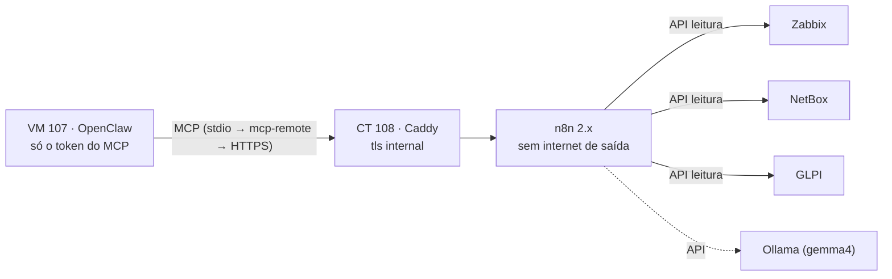

# n8n — orquestração do NOC (CT 108)

O agente de IA (OpenClaw, modelo local de 12B) **não seguia de forma confiável** uma cadeia de 5 ferramentas (Zabbix → NetBox → GLPI): pulava etapas, chutava conversão de horário e chegou a escrever "0 chamados" ao lado de dois chamados abertos. Mais instrução no prompt dava ganho decrescente.

A orquestração saiu do modelo: um workflow do **n8n** faz as consultas de forma **determinística** e entrega ao agente, via **MCP**, um JSON curto e já cruzado. O agente só apresenta e comenta.

## Ganhos

- Mesmas consultas e mesmos campos a cada execução; horário convertido no fluxo (America/Fortaleza); chamados só com status 1–4 confirmados no GLPI.
- **Tokens fora da VM do agente:** o OpenClaw guarda só o Bearer do MCP do n8n.
- Uma ferramenta e um JSON curto no contexto do agente (menos compactação).
- Campo `fontes` por sistema: se o GLPI falhar, o agente diz que falhou em vez de inventar "0 chamados".

## Container

| Item | Valor |
|---|---|
| Tipo | LXC **não privilegiado** com Docker (`nesting=1,keyctl=1`), Debian 13, 2 vCPU / 2 GB / 16 GB em `ssd-dados` |
| Rede | VLAN de serviços, IPv6 desativado, SSH desligado (acesso por `pct enter`) |
| Firewall | [`ct.fw.example`](ct.fw.example): entrada 443 só da administração e da VM do agente; **saída só para as 4 APIs + DNS** |
| n8n | [`compose.yml.example`](compose.yml.example): imagem com versão fixa, sem porta publicada, telemetria/templates/aviso de versão desligados, nós `executeCommand`/`ssh`/`localFileTrigger` bloqueados, execuções apagadas após 7 dias |
| HTTPS | [`Caddyfile.example`](Caddyfile.example): `tls internal` + `default_sni` (acesso por IP) e `flush_interval -1` para o SSE do MCP |
| Acesso | Owner com MFA; cadastro público desativado; **nunca publicado no proxy** |
| Backup | Job diário (snapshot, ~1 GB) + cópia semanal criptografada; `N8N_ENCRYPTION_KEY` também no gerenciador de senhas |

> **Destinos com dois firewalls:** o GLPI e o NetBox rodam em Docker. No GLPI, a chain `DOCKER-USER` tem lista de IPs própria ([`firewall-docker-glpi.sh`](../glpi/firewall-docker-glpi.sh)) — além do `.fw` do Proxmox, todo cliente novo precisa entrar ali **e** ter cliente de API com o IP no GLPI.

## Credenciais (somente leitura, próprias do n8n)

| Sistema | Usuário / chave | Restrição |
|---|---|---|
| Zabbix | Usuário próprio com a role de API em **lista de permissões** (`*.get`) + token | O Zabbix não restringe token por IP: proteção pela role e pelo firewall |
| NetBox | Usuário com permissão só **View** + token **v2** sem escrita | IPs permitidos `<ip>/32,::ffff:<ip>/128` |
| GLPI | Cliente de API com o IP do CT + usuário com perfil só leitura, **no grupo NOC** | Faixa IP + perfil |

No n8n: **Header Auth** (`Authorization: Bearer …`) para Zabbix e NetBox, **Custom Auth** para o GLPI (`{"headers":{"App-Token":"…","Authorization":"user_token …"}}`) e a credencial nativa do Ollama.

Teste de cada token no CT, antes de cadastrar: leitura ok **e escrita negada** (`host.create`, `POST /api/dcim/sites/`, `POST /Ticket`).

## Workflows ([`workflows/`](workflows))

| Arquivo | Função |
|---|---|
| [`teste-credenciais.json`](workflows/teste-credenciais.json) | Chama as 4 APIs em sequência — valida as credenciais de dentro do n8n |
| [`noc_resumo.json`](workflows/noc_resumo.json) | `problem.get` (`sortfield: eventid`, 50, com tags) → `event.get` (host) → `host.get` (IP, manutenção) → NetBox (site/função) → GLPI (sessão, chamados abertos, `killSession` mesmo em erro) → **Montar resumo** |
| [`mcp_noc.json`](workflows/mcp_noc.json) | **MCP Server Trigger** (Bearer, path `noc`) + ferramenta `noc_resumo` |

O **Montar resumo** (nó Code) liga problema ↔ chamado pela tag `__zbx_glpi_ticket_id` que a [integração Zabbix → GLPI](../zabbix-glpi/README.md) grava no evento, e confirma status e data **no GLPI**. Também calcula as sinalizações: causa comum (2+ hosts no mesmo site), Alta/Desastre sem chamado, chamado aberto sem problema e host em manutenção.

Ao importar:
- O arquivo não leva credenciais: **conferir a credencial de cada nó** — o n8n atribui a mesma credencial a todos os nós do mesmo tipo (Zabbix e NetBox são ambos Header Auth).
- No `mcp_noc`, escolher o workflow `noc_resumo` na ferramenta e **publicar os dois** (sem publicar, a rota `/mcp/noc` responde 404 — `webhook "POST noc" is not registered`).
- O nome da ferramenta exposta no MCP é o **nome do nó**; o nó se chama `noc_resumo` para casar com o filtro do agente.

## Ligação com o OpenClaw

Ver [OpenClaw → MCP do n8n](../openclaw/README.md#resumo-do-noc-via-n8n-mcp). Resumo: stdio + [`mcp-remote`](https://www.npmjs.com/package/mcp-remote) com versão fixa, token num `.env` 600 e TLS validado pela CA do Caddy (`NODE_EXTRA_CA_CERTS`).

## Atualização ([`atualizacao/`](atualizacao))

Exceção à política de atualizações sob demanda: o n8n teve várias falhas críticas em 2026, algumas exploradas ativamente.

| Arquivo | Onde | Função |
|---|---|---|
| [`n8n-check`](atualizacao/n8n-check) | `/usr/local/sbin/` (host) | Compara a versão em uso com a última estável do GitHub e com os **avisos de segurança**; envia ao Zabbix pelo protocolo trapper (sem pacote extra) |
| [`n8n-check.timer`](atualizacao/n8n-check.timer) / [`.service`](atualizacao/n8n-check.service) | `/etc/systemd/system/` | Segunda 08:10, `Persistent=true` (dual boot) |
| [`n8n-update.sh <versão>`](atualizacao/n8n-update.sh) | `/usr/local/sbin/` | Confirmação → snapshot do CT → abre 80/443 de saída → troca a tag, `pull`, `up -d` → **fecha a saída** (inclusive em erro) → `healthz` → nova checagem. Em falha, mostra o `pct rollback` (o n8n migra o banco ao subir: voltar só a tag não basta) |

**Zabbix** (host interno "Zabbix server", fora do sync do NetBox): itens *Zabbix trapper* `n8n.update.status` (numérico) e `n8n.update.info` (texto), *Allowed hosts* = IP do host Proxmox; porta 10051 liberada só para ele no firewall do CT do Zabbix.

| Status | Significado | Trigger |
|---|---|---|
| 0 | Atualizado | — |
| 1 | Versão estável nova | Atenção |
| 2 | Versão em uso **afetada** por aviso de segurança | Média (Alta abriria chamado no GLPI pela integração) |
| 3 | Checagem falhou | Atenção |
| — | Sem dados há 8 dias (`nodata`) | Atenção |

> **Avisos de segurança do n8n** trazem uma faixa por linha de versão, quase sempre só com limite superior (`< 2.46.1`, `< 2.45.5`, `< 3.0.1`). Lida isoladamente, `< 3.0.1` marca toda a linha 2.x como afetada. O `n8n-check` avalia por linha: correção na mesma `major.minor` → afetada se abaixo dela; senão, correção anterior na mesma major → corrigida.

## Validação (03/11/2026)

- `noc_resumo` com dois hosts de teste (ICMP, Alta): chamados #7/#8 ligados e confirmados no GLPI, horário exato, sem sinalização falsa.
- Pelo agente: "Me dá o resumo do NOC" → **1 chamada de ferramenta**, 24 s, dados idênticos ao workflow.
- Backup manual do CT: snapshot com Docker dentro do LXC ok (46 s, ~1 GB).

## Verificação de CTOs (IXC → Discord)

Segundo uso do CT (03/11/2026): monitoramento de fibra a partir do ERP IXC, com Postgres próprio no mesmo Compose e alertas editáveis no Discord — ver [`verificacao-ctos/`](verificacao-ctos/README.md).

Mudanças no CT para isso:
- **Saída permanente** (exceção à regra "só para atualizar"): API do IXC (443, IP do servidor) e API do Discord (443, faixa da Cloudflare) — ver [`ct.fw.example`](ct.fw.example)
- `compose.override.yml` com `postgres:17` na rede `interna`, sem porta publicada
- Fuso no banco: `ALTER DATABASE noc SET timezone TO 'America/Fortaleza'` — o `PGTZ` do container **não** vale para a conexão do n8n

## Próximos passos

- Resumo em horário fixo enviado ao canal da equipe (substitui o heartbeat do agente)
- Detalhe de um host específico como segunda ferramenta
- Fluxos de escrita com aprovação humana (tokens de escrita mínimos e separados)
