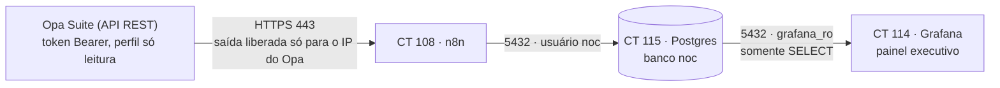

# Atendimento — Opa Suite → n8n → Postgres → Grafana

Painel executivo de atendimento ao cliente para a diretoria, alimentado pela API do **Opa Suite** (plataforma de atendimento omnichannel). O n8n sincroniza os atendimentos a cada 5 minutos num Postgres central ([CT 115](../../postgres-noc/README.md)) e o Grafana ([CT 114](../../grafana/README.md)) só lê.



## Fluxos ([`workflows/`](workflows))

| Workflow | Quando | Função |
|---|---|---|
| [`opa_sync_catalogos`](workflows/opa_sync_catalogos.json) | Diário 04:20 | Canais, atendentes, setores e motivos → tabelas de apoio (resolve ID → nome) |
| [`opa_sync_atendimentos`](workflows/opa_sync_atendimentos.json) | 5 min | Duas janelas de 2 dias (**abertura** e **encerramento**) → upsert em `opa_atendimentos` |
| [`opa_backfill_atendimentos`](workflows/opa_backfill_atendimentos.json) | Manual | Carga histórica dia a dia, em blocos (`diasInicio`/`diasFim` no nó **Config**) |

- **Janela de encerramento:** sem ela, um atendimento aberto antes da janela ficaria "em aberto" para sempre no banco.
- **Data final:** a janela vai até **amanhã**, porque a API só aceita o dia (`yyyy-MM-dd`) e não documenta se a data final é inclusiva.
- **Upsert idempotente:** repetir o backfill não duplica nada; serve para reprocessar depois de corrigir a transformação.
- **Log em `opa_sync_log`:** registra cada execução e grava `verificar_paginas` quando a última página de alguma janela volta cheia (registro pode ter ficado de fora).

### Ao importar

- Os arquivos **não levam credenciais nem o domínio**:
  - Criar uma credencial **Header Auth** com `Authorization` = `Bearer <token>` e uma credencial **Postgres** apontando para o CT 115.
  - Conferir a credencial **de cada nó**.
  - Trocar `<servidor-opa>` no nó **Config** de cada fluxo.
- Rodar `opa_sync_catalogos` **antes** do primeiro sync/backfill. Senão setor, atendente e motivo ficam com o ID bruto até o próximo upsert.
- Backfill em blocos de **15 dias** por segurança. 30 dias (~12 mil registros) passaram, mas uma execução manual chegou a cair com o CT em 2 GB e swap em uso: o executor de Code nodes não aceitou a tarefa a tempo ([lições](../../../docs/licoes-aprendidas.md)). Depois disso, o CT foi para 4 GB e "separar" e "normalizar" viraram um nó só.

### Por que HTTP Request + credencial, e não Code node com `$env`

- O n8n 2.x bloqueia `$env` dentro do Code node por padrão, e **Variables** depende da licença da instância.
- O nó **HTTP Request** com credencial Header Auth guarda o token cifrado no n8n, sem mexer no Compose.
- O Code node fica só para transformar dados, sem nenhuma chamada de API dentro de código.

## API do Opa Suite — o que importa

- Listagens são **`GET` com corpo JSON**: `{"filter": {...}, "options": {"skip": N, "limit": N}}`.
- **Pelo menos um filtro válido é obrigatório** em quase todas as listagens. Corpo vazio ou `filter: {}` devolve `400 NO_ARGUMENT_ERROR`, e campo fora da lista do endpoint devolve `400 ARGUMENT_VALUE_ERROR`.
- **Limite real de 1000 por chamada**, mesmo pedindo mais, e **sem aviso**. Paginar com `skip`.
- O perfil do token precisa de **Visualizar** em Atendimentos, Departamentos, Usuários, Motivos de atendimento e Canais de comunicação. Sem isso, a resposta é `403 Invalid permissions profile / Bad role`. Nada além de leitura.

| Endpoint | Filtros aceitos | Como listar "tudo" |
|---|---|---|
| `/atendimento/` | `protocolo`, `dataInicial/FinalAbertura`, `dataInicial/FinalEncerramento`, `id_atendente`, `status`, `canal_id`, `setor`, `id_cliente`, `motivos.idMotivo`, `evaluations.*.rating` | Janela de datas + paginação (máx. 1 ano por consulta) |
| `/canal-comunicacao/` | `_id`, `nome`, `id_atendente`, `status`, `canal`, `integracao` | `status: "A"` e `status: "I"` |
| `/usuario/` | `nome`, `status`, `tipo` | `status: "A"` e `status: "I"` |
| `/departamento/` | `nome` (igualdade exata), `token`, `cod_pabx`, `recebeAtendimento` | `recebeAtendimento: true` (trouxe ativos e inativos) |
| `/motivo` | `motivo`, `departamentos` | **Não existe**: buscar por departamento, um a um |

Formato real do atendimento (diferente dos exemplos antigos da documentação):
- **`status`:** `EA` (em atendimento), `AG` (aguardando na fila) e `F` (finalizado).
- **`motivos`:** lista `[{ idMotivo, idAtendente, idDepartamento, data }]`. O campo antigo `id_motivo_atendimento` ainda é lido por compatibilidade.
- **`evaluations`:** é uma **lista** `[{ metric: "likert", likert: { rating, topic }, date }]`, não o objeto que o nome do filtro `evaluations.likert.rating` sugere. Escala de 1 a 5.
- **`canal`:** vem em minúsculas (`whatsapp`, `page`…). O banco grava o tipo do catálogo (`Whatsapp`, `Instagram`, `Messenger`, `Page` → **Web Chat**), e não o nome da instância.

## Banco (`noc`, CT 115)

> O `.gitignore` do repositório bloqueia `*.sql`, por isso o schema fica aqui.

```sql
CREATE TABLE IF NOT EXISTS opa_canais   (id text PRIMARY KEY, nome text, canal text, status text, integracao text, atualizado_em timestamptz);
CREATE TABLE IF NOT EXISTS opa_usuarios (id text PRIMARY KEY, nome text, status text, tipo text, atualizado_em timestamptz);
CREATE TABLE IF NOT EXISTS opa_setores  (id text PRIMARY KEY, nome text, status text, atualizado_em timestamptz);
CREATE TABLE IF NOT EXISTS opa_motivos  (id text PRIMARY KEY, motivo text, atualizado_em timestamptz);

CREATE TABLE IF NOT EXISTS opa_atendimentos (
  id text PRIMARY KEY,            -- _id do atendimento
  protocolo text,
  status text,                    -- EA | AG | F
  canal_tipo text, canal_id text,
  canal text,                     -- tipo resolvido (Whatsapp, Web Chat, Instagram, Messenger…)
  setor_id text, setor text,      -- nome via opa_setores (fallback: id)
  atendente_id text, atendente text,
  motivo_id text, motivo text,
  data_abertura timestamptz, data_encerramento timestamptz,
  fora_horario boolean,           -- regra provisória: seg-sex 8h-18h, sáb 8h-12h (Fortaleza)
  rating numeric,                 -- pesquisa do cliente (likert 1-5); a nota da IA não entra
  atualizado_em timestamptz
);
CREATE INDEX IF NOT EXISTS idx_opa_atendimentos_abertura ON opa_atendimentos (data_abertura);
CREATE INDEX IF NOT EXISTS idx_opa_atendimentos_setor    ON opa_atendimentos (setor);
CREATE INDEX IF NOT EXISTS idx_opa_atendimentos_status   ON opa_atendimentos (status);

CREATE TABLE IF NOT EXISTS opa_sync_log (
  id bigserial PRIMARY KEY, fluxo text, executado_em timestamptz, registros int, status text, erro text
);
```

Tabelas criadas pelo `postgres`: depois do schema, dar `ALL` ao usuário `noc` (inclusive `ALTER DEFAULT PRIVILEGES`) e só `SELECT` ao `grafana_ro` — ver [CT 115](../../postgres-noc/README.md).

Conferência depois da carga (resolução de nomes, status, escala de satisfação):

```sql
SELECT count(*) FILTER (WHERE setor = setor_id)                               AS setor_sem_nome,
       count(*) FILTER (WHERE atendente IS NULL AND atendente_id IS NOT NULL) AS atendente_sem_nome,
       count(*) FILTER (WHERE motivo IS NULL AND motivo_id IS NOT NULL)       AS motivo_sem_nome,
       count(rating) AS com_nota, min(rating), max(rating)
FROM opa_atendimentos;
SELECT status, count(*) FROM opa_atendimentos GROUP BY 1;
SELECT * FROM opa_sync_log ORDER BY id DESC LIMIT 5;
```

## LGPD

- **Banco:** nenhum dado do cliente final.
  - Nunca gravados: `id_cliente`, `id_user`, `canal_cliente`, tags, observações e mensagens.
  - Do catálogo de usuários, só ficam nome, status e tipo. A API também devolve e-mail e token de dispositivo.
- **Execuções do n8n:** as com sucesso e as manuais **não ficam salvas**, porque as respostas brutas trazem esses campos. Execuções com erro ficam pelo prazo padrão da instância.
- **Grafana:** lê com usuário próprio, só `SELECT`.

## Painel

Painel executivo: [`servicos/grafana`](../../grafana/README.md#atendimento-ao-cliente--opa-suite).

## Pendências

- Horário comercial real pelo endpoint de períodos do Opa, em vez da regra fixa.
- Aviso no Zabbix quando o sync parar (o painel já mostra "dados atualizados há X min").
- Carga histórica dos 30 dias anteriores ao primeiro mês, para a comparação "vs período anterior" do painel.
