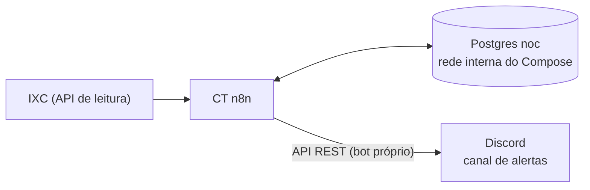

# Verificação de CTOs — IXC → n8n → Discord

Monitoramento de **fibra** a partir do ERP **IXC Provedor**: o n8n monta o mapa **cliente → CTO → PON** num Postgres próprio, cruza a cada 5 minutos os logins que caíram e publica no Discord **uma mensagem por alerta**, editada conforme o alerta evolui (🔴 novo → 🟠 agravado → 🟢 normalizado).

Substitui um modelo antigo (telemetria + banco) que consultava a porta da CTO cliente a cliente e alertava com 80% da **capacidade** da caixa.

## Fluxos ([`workflows/`](workflows))

| Workflow | Quando | Função |
|---|---|---|
| [`ixc_sync_ctos`](workflows/ixc_sync_ctos.json) | Semanal | OLTs (transmissores com nome começando em "OLT") e CTOs |
| [`ixc_sync_clientes`](workflows/ixc_sync_clientes.json) | Diário | Mapa ONU → login → contrato → CTO/porta/PON + cadastro pendente |
| [`cto_verificacao`](workflows/cto_verificacao.json) | 5 min | Logins offline → `quedas` → correlação → abre, atualiza e fecha `alertas` |
| [`cto_notificar`](workflows/cto_notificar.json) | 1 min | Alertas pendentes → `POST` (novo) ou `PATCH` (edição) no Discord |

Banco: [`schema.sql`](schema.sql) · Postgres: [`compose.override.yml.example`](compose.override.yml.example).

Ao importar: os arquivos não levam credenciais. Conferir a credencial **de cada nó** (Basic Auth do IXC, Postgres, Header Auth do Discord) e trocar `<servidor-ixc>` e `<id-do-canal>`.

**Proteções nas sincronizações:**
- Paginação conferida contra o `total` do IXC.
- Base incompleta **aborta antes de gravar**, para nunca apagar a tabela por falha da API.
- Nos sincronismos, o `DELETE` dos registros que sumiram só roda com dados novos.

## Regras

| Regra | Valor |
|---|---|
| Entra no mapa | Login ativo + contrato `A` (ativo) ou `FA` (financeiro em atraso) + ONU vinculada |
| Quedas | Login do mapa, ainda offline, `motivo_desconexao` **Lost-Carrier/Lost-Service**, últimos 15 min |
| Correlação | Quedas do grupo dentro de 10 min |
| Alerta de **PON** (OLT + `ponid`) | ≥ 5 offline **e** ≥ 30% das ONUs da PON |
| Alerta de **CTO** | ≥ 2 offline **e** ≥ 60% dos clientes, só fora de PON em alerta |
| Repetição | 1 alerta aberto por PON/CTO (índice único parcial); afetados novos entram no mesmo alerta |
| Agravado | Já notificado e cresceu ≥ 50% → edita a mensagem |
| Normalizado | Aberto há > 4 min e ≤ 20% dos afetados ainda offline → edita com a duração |

Com ~2,5 clientes por CTO, a regra de porcentagem sozinha na CTO vira "todos offline": por isso a **PON vem primeiro**. Ela também tolera cliente cadastrado na CTO errada, porque a PON vem da OLT, não do cadastro.

## API do IXC — o que importa

- `POST /webservice/v1/<tabela>` com o header `ixcsoft: listar`. **Basic Auth**: o usuário é o **ID numérico** do usuário de API, a senha é o token.
- Filtros extras em `grid_param`, que é uma **string** JSON (`[{"TB":"tabela.campo","OP":">=","P":"valor"}]`). Datas no formato `AAAA-MM-DD HH:MM:SS`, em horário local.

| Tabela | Achado |
|---|---|
| `radusuarios` | `id_caixa_ftth`/`ftth_porta` do **login** vêm `0`: o vínculo com a CTO está na **ONU**. `tipo_conexao_mapa` separa fibra (`F`) de rádio e dedicado |
| `radpop_radio_cliente_fibra` | Traz CTO, porta, OLT e `ponid`. O formato do `ponid` muda por fabricante (`1-1-4-2`, `1/1/2`, `1/2`), então a chave é `id_transmissor` + `ponid` como vem. `causa_ultima_queda` veio vazia (não separa LOS × energia). `sinal_rx`/`data_sinal` **não são tempo real**: servem só de contexto |
| `cliente_contrato` | `status_internet`: `A`, `FA` entram; `AA` (aguardando assinatura), `D`, `CA`/`CM` ficam fora |
| `radpop_radio` | Guarda login/senha/IP das OLTs: o fluxo **não grava** esses campos |

## Discord

- **Bot próprio**, separado do agente de IA: Public Bot desligado, sem Privileged Intents.
- **Permissões:** Ver canais, Enviar mensagens e Inserir links (`19456`), só no canal de alertas.
- **Envio:** `POST /channels/{id}/messages` (guarda o ID da mensagem) e `PATCH …/messages/{id}`.
  - Editar a própria mensagem não precisa de "Gerenciar mensagens".
  - A edição **não notifica** ninguém, de propósito.
  - Se a mensagem for apagada (404), ela é recriada no ciclo seguinte.
- **Firewall do CT:** saída 443 só para a faixa da Cloudflare onde a API do Discord resolve. `gateway.discord.gg` não é liberado, porque o bot só usa REST e aparece offline.

## LGPD

- **Banco:** só IDs e dados técnicos. Nome, endereço, CPF e senha PPPoE são descartados no nó de mapeamento.
- **Execuções salvas no n8n:** as com sucesso dos fluxos do IXC **não ficam salvas**, porque as respostas brutas têm dados pessoais.
- **Mensagem no Discord:** só dados de rede (OLT, PON, CTO, portas, contagens, horários, link do mapa da CTO). **Nenhum ID de cliente.**
