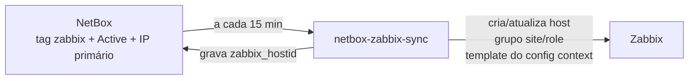

# Sincronização NetBox → Zabbix

O NetBox é a fonte da verdade: os equipamentos marcados com a tag `zabbix` viram hosts no Zabbix automaticamente, com grupo e template definidos pelo próprio NetBox. **Padrão: ICMP Ping**; SNMP e templates específicos só por exceção, no *local config context* do device.

Ferramenta: [netbox-zabbix-sync](https://github.com/TheNetworkGuy/netbox-zabbix-sync) (4.1.0), em virtualenv no container do Zabbix, rodando por um systemd timer a cada 15 minutos.

## Fluxo



## Preparação no NetBox

| Objeto | Campo | Uso |
|---|---|---|
| Device | `zabbix_hostid` (Integer) | ID do host no Zabbix, gravado pela ferramenta |
| Device type | `zabbix_template` (Text) | Não usado desde 30/10/2026 — o template vem do config context (mantido como reserva) |
| Tag | `zabbix` | Seleciona o que é monitorado |

## Configuração (resumo de `config.py`)

- Filtro: tag `zabbix`, status ativo, com IP primário
- Grupos de hosts: `site/role` (ex.: `POP Centro/Concentrador`)
- Template: **config context** (`templates_config_context = True` e `templates_config_context_overrule = True` — o contexto prevalece sobre o campo do tipo)
- Interface definida por **config context** no NetBox (veja abaixo); community pela macro `{$SNMP_COMMUNITY}`
- `usermacro_sync = "full"`: macros do host vêm do NetBox (inclusive secretas)
- Tokens em `/etc/netbox-zabbix-sync/sync.env` (permissão 600), carregado pelo systemd

## Template, porta e community por equipamento (config context)

A maioria dos equipamentos só precisa de ping; os SNMP têm template, porta e community próprios. Editar a interface no Zabbix não adianta (o sync sobrescreve), então tudo fica no NetBox:

| Camada no NetBox | Arquivo | Uso |
|---|---|---|
| Config context global `zabbix-padrao-icmp` (só a tag `zabbix`, peso 1000) | [`zabbix-padrao-icmp.json`](config-context/zabbix-padrao-icmp.json) | Template **ICMP Ping**; interface tipo 1 só para o Zabbix saber o IP (sem agente) |
| *Local config context* do device SNMP | [`device-local.example.json`](config-context/device-local.example.json) | Interface SNMP completa (`interface_type: 2`, porta, `snmp`), `templates` e macro `{$SNMP_COMMUNITY}` secreta |

O NetBox mescla as duas camadas (o local prevalece). Listas **não se somam**: o `templates` do local substitui o do global, então o SNMP fica só com o template dele. No Zabbix a interface continua com `{$SNMP_COMMUNITY}`; o valor vem da macro do host (prioridade: host → template → global).

Detalhes da versão 4.1.0 (lidos no código):
- `interface_port` só é lido se `interface_type` existir no context — o local dos SNMP declara a interface completa.
- `interface_type` do contexto é aplicado **mesmo sem** `templates_config_context`: com o global ativo, um SNMP sem local recebe interface tipo 1.
- Conferir a aba *Contexto de configuração* do device: **Contextos de Origem** mostra se o global está casando; o renderizado deve ter só o template certo.

**Ordem segura para ligar o template por contexto** (ou mudar o global):
1. Local completo em **todos** os SNMP (`interface_type: 2`, `snmp`, `templates`, macro)
2. Global ativo
3. `config.py` → `templates_config_context` e `overrule` em `True`
4. `systemctl start netbox-zabbix-sync.service` e ler o log

> Fora dessa ordem, o sync troca o template SNMP pelo ICMP Ping com `templates_clear` — **itens e histórico do template removido são apagados**. Depois de corrigir, forçar as regras de descoberta (*Executar agora*).
- `bulk: 0` (sem requisições combinadas) usado no equipamento atrás de NAT/redirecionamento de porta: respostas UDP grandes podem não voltar.
- Com `interface_type: 2` o bloco `snmp` com `version` é obrigatório.
- `usermacro_sync`: `True` sincroniza; `"full"` também força o reenvio (a API do Zabbix não devolve o valor de macros secretas, então só o `full` propaga uma troca de community). Efeito colateral normal: `Usermacros OUT of sync` em **toda** execução nos hosts com macro secreta.
- Com o sync de macros ligado, **macros criadas à mão no host são substituídas** pelas do NetBox. Migre as exceções para o NetBox antes de ligar.
- O mapeamento padrão (`device_usermacro_map`) também cria `{$DEV_ROLE}`, `{$NB_ID}`, `{$NB_URL}` e `{$HW_SERIAL}` (este só se o device tiver serial).

Acesso ao NetBox restrito à equipe do NOC — por isso a community pode ficar no *local config context* (visível a quem vê o device e no changelog).

### Bug do 4.1.0: macro secreta gravada como `********`

`sanatize_log_output()` (em `modules/tools.py`) mascara os segredos para o log, mas usa `data.copy()` (cópia **rasa**): os dicionários das macros são os mesmos enviados ao Zabbix, que recebe `********` como valor. A função é chamada mesmo com log em `info`. Afeta também os `details` de interface (SNMPv3).

Correção local ([patch](patches/sanatize-deepcopy.patch)):
```bash
F=/opt/netbox-zabbix-sync/lib/python3.13/site-packages/netbox_zabbix_sync/modules/tools.py
cp $F $F.bak
sed -i 's/^    sanitized_data = data.copy()$/    import copy\n    sanitized_data = copy.deepcopy(data)/' $F
/opt/netbox-zabbix-sync/bin/python -c "import netbox_zabbix_sync.modules.tools as t; d={'macros':[{'type':'1','value':'x'}]}; t.sanatize_log_output(d); print(d)"
# esperado: value 'x' intacto
```
> Reaplicar após qualquer `pip install -U netbox-zabbix-sync`.

## systemd

[`netbox-zabbix-sync.service`](netbox-zabbix-sync.service) roda como usuário dinâmico sem privilégios e com sistema de arquivos somente leitura; [`netbox-zabbix-sync.timer`](netbox-zabbix-sync.timer) agenda a cada 15 minutos.

## Segurança das contas de integração

- **Token v2 do NetBox restrito por IP** ao container do Zabbix. Atenção: com o servidor web dual-stack, o NetBox vê o cliente como `::ffff:<ipv4>` — a lista de IPs permitidos precisa ter **também** `::ffff:<ipv4>/128`, senão a API devolve 403.
- A API do NetBox só aceita o container do Zabbix (firewall do Proxmox) e a rede de administração.
- Próximo passo: reduzir as permissões (NetBox: permissões por objeto; Zabbix: role própria limitada aos grupos sincronizados).

## Operação

- Novo equipamento só ICMP: Active + IP primário → tag `zabbix`.
- Novo equipamento SNMP: Active + IP primário → *local config context* completo → **depois** a tag `zabbix`.
- Remover: mudar o status para Decommissioning/Inventory **antes** de tirar a tag; senão o host fica órfão no Zabbix.
- O NetBox manda: template, grupos, interface e macros editados à mão no Zabbix são sobrescritos. Porta/community diferente → *local config context* do device.
- **Nunca** crie uma segunda interface SNMP à mão: o sync para com `Multiple interfaces of the same type ... manual intervention required` e deixa de atualizar o host.
- Conferir o valor real de uma macro secreta (o Zabbix só esconde na interface):
  ```bash
  su - postgres -c "psql -d zabbix -c \"SELECT h.host, m.macro, m.type, m.value FROM hostmacro m JOIN hosts h ON h.hostid=m.hostid WHERE m.macro LIKE '%SNMP_COMMUNITY%';\""
  ```
  Evite `$` dentro de comandos com várias camadas de shell (`pct exec` → `su -c`): o `$SNMP_COMMUNITY` vira variável vazia.
