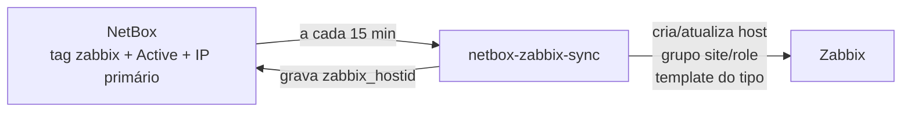

# Sincronização NetBox → Zabbix

O NetBox é a fonte da verdade: os equipamentos marcados com a tag `zabbix` viram hosts no Zabbix automaticamente, com grupo e template definidos pelo próprio NetBox.

Ferramenta: [netbox-zabbix-sync](https://github.com/TheNetworkGuy/netbox-zabbix-sync) (4.1.0), em virtualenv no container do Zabbix, rodando por um systemd timer a cada 15 minutos.

## Fluxo

## Preparação no NetBox

| Objeto | Campo | Uso |
|---|---|---|
| Device | `zabbix_hostid` (Integer) | ID do host no Zabbix, gravado pela ferramenta |
| Device type | `zabbix_template` (Text, padrão `Mikrotik by SNMP`) | Template aplicado aos dispositivos daquele tipo |
| Tag | `zabbix` | Seleciona o que é monitorado |

## Configuração (resumo de `config.py`)

- Filtro: tag `zabbix`, status ativo, com IP primário
- Grupos de hosts: `site/role` (ex.: `POP Centro/Concentrador`)
- Template: campo `zabbix_template` do tipo de dispositivo
- Interface SNMP v2c com a community vinda da macro **`{$SNMP_COMMUNITY}`** (macro global secreta no Zabbix — o valor nunca fica no NetBox nem aqui)
- Tokens em `/etc/netbox-zabbix-sync/sync.env` (permissão 600), carregado pelo systemd

## systemd

[`netbox-zabbix-sync.service`](netbox-zabbix-sync.service) roda como usuário dinâmico sem privilégios e com sistema de arquivos somente leitura; [`netbox-zabbix-sync.timer`](netbox-zabbix-sync.timer) agenda a cada 15 minutos.

## Segurança das contas de integração

- **Token v2 do NetBox restrito por IP** ao container do Zabbix. Atenção: com o servidor web dual-stack, o NetBox vê o cliente como `::ffff:<ipv4>` — a lista de IPs permitidos precisa ter **também** `::ffff:<ipv4>/128`, senão a API devolve 403.
- A API do NetBox só aceita o container do Zabbix (firewall do Proxmox) e a rede de administração.
- Próximo passo: reduzir as permissões (NetBox: permissões por objeto; Zabbix: role própria limitada aos grupos sincronizados).

## Operação

- Novo equipamento: Active + IP primário → conferir `zabbix_template` do **tipo** → tag `zabbix`.
- Remover: mudar o status para Decommissioning/Inventory **antes** de tirar a tag; senão o host fica órfão no Zabbix.
- O NetBox manda: template, grupos e interface editados à mão no Zabbix são sobrescritos. Para uma community diferente em um host, use uma **macro no host**.
