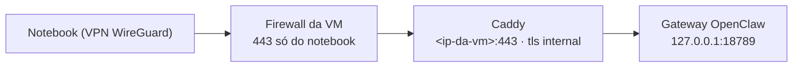

# OpenClaw — agente de IA isolado (VM 107)

Agente [OpenClaw](https://openclaw.ai) (2026.10.x) usando o modelo local do Ollama, montado para atuar como apoio N2 do NOC com **acesso somente leitura**.

## Camadas de isolamento

| Camada | Controle |
|---|---|
| VM própria | Kernel separado dos containers; snapshot antes de cada mudança |
| Firewall do Proxmox | Entrada só SSH da gerência e 443 do notebook na VPN; **saída fechada** (`policy_out: DROP`), liberada destino a destino |
| Usuário | `openclaw` sem sudo |
| Sandbox | Docker **rootless** (containers sem root real e sem acesso ao loopback da VM) |
| Gateway | Só em `127.0.0.1:18789`; painel por HTTPS (Caddy na própria VM) apenas do notebook na VPN |
| Segredos | Token do gateway fora do `openclaw.json` (SecretRef `env` + `EnvironmentFile` 600); tokens de MCP em `.env` 600 lidos por `run.sh` |
| Skills | Nenhuma da galeria pública sem revisão |

## Firewall da VM — [`vm.fw.example`](vm.fw.example)

## Instalação resumida

```bash
# como root na VM
adduser --disabled-password --gecos "" openclaw
apt install -y uidmap dbus-user-session systemd-container curl git ca-certificates
loginctl enable-linger openclaw
curl -fsSL https://get.docker.com | sh
systemctl disable --now docker.socket docker.service      # só o modo rootless
curl -fsSL https://deb.nodesource.com/setup_24.x | bash - && apt install -y nodejs   # >= 24.22.1

# sessão do usuário (colar a linha abaixo sozinha)
machinectl shell openclaw@
dockerd-rootless-setuptool.sh install && systemctl --user enable --now docker
echo 'export DOCKER_HOST=unix:///run/user/$(id -u)/docker.sock' >> ~/.bashrc
npm config set prefix ~/.npm-global && echo 'export PATH=$HOME/.npm-global/bin:$PATH' >> ~/.bashrc
curl -fsSL https://openclaw.ai/install.sh -o /tmp/openclaw-install.sh && less /tmp/openclaw-install.sh && bash /tmp/openclaw-install.sh
# Quick start → One agent → provedor: Skip → sem canal → sem skills
```

## Modelo no Ollama de outro host

Ollama remoto exige o modelo declarado (sem descoberta automática). Use a **API nativa — sem `/v1`**, senão o *tool calling* quebra:

```json5
{
  models: { providers: { ollama: {
    baseUrl: "http://<ip-do-ollama>:11434", apiKey: "ollama-local", api: "ollama",
    timeoutSeconds: 300, maxTokens: 4096,
    models: [{ id: "gemma4:12b", reasoning: false, input: ["text"],
               contextTokens: 32768, params: { num_ctx: 32768, keep_alive: "15m" } }]
  } } },
  agents: { defaults: { model: { primary: "ollama/gemma4:12b" } } }
}
```
`params.num_ctx` vale só para as requisições do OpenClaw (o padrão do Ollama, usado por outros clientes, não muda).

## Gateway e segredo

```bash
chmod go-w ~ ~/.config ~/.config/systemd && chmod 700 ~/.config/systemd/user   # o install recusa pastas graváveis por outros
openclaw gateway install

# token fora do config
mkdir -p ~/.config/openclaw && chmod 700 ~/.config/openclaw
read -rsp "token: " T; printf 'OPENCLAW_GATEWAY_TOKEN=%s\n' "$T" > ~/.config/openclaw/gateway.env; unset T; chmod 600 ~/.config/openclaw/gateway.env
mkdir -p ~/.config/systemd/user/openclaw-gateway.service.d
printf '[Service]\nEnvironmentFile=%%h/.config/openclaw/gateway.env\n' > ~/.config/systemd/user/openclaw-gateway.service.d/secrets.conf
systemctl --user daemon-reload
set -a; . ~/.config/openclaw/gateway.env; set +a
openclaw secrets configure     # env · alias gateway · allowlist/id OPENCLAW_GATEWAY_TOKEN
openclaw secrets audit --check # clean
```

## Sandbox e política de ferramentas

Base: `docs/gateway/security/hardened-baseline.md` (sem copiar o bloco `gateway`, para não trazer o token em texto).

```json5
tools: {
  deny: ["group:automation","group:runtime","group:fs","group:web","browser","sessions_spawn","sessions_send"],
  sandbox: { tools: { deny: [/* mesma lista */] } },   // defesa em profundidade
  fs: { workspaceOnly: true }, exec: { security: "deny", ask: "always" },
  elevated: { enabled: false }, sessions: { visibility: "agent" }, agentToAgent: { enabled: false },
},
agents: { defaults: { sandbox: { mode: "all", scope: "session", workspaceAccess: "none" } } }
```

```bash
# o serviço do gateway não lê o .bashrc: apontar para o Docker rootless
printf '[Service]\nEnvironment=DOCKER_HOST=unix://%%t/docker.sock\n' > ~/.config/systemd/user/openclaw-gateway.service.d/docker.conf

# imagem do sandbox (o pacote npm não traz scripts/sandbox-setup.sh)
docker build -t openclaw-sandbox:bookworm-slim - <<'DOCKERFILE'
FROM debian:bookworm-slim
ENV DEBIAN_FRONTEND=noninteractive
RUN apt-get update && apt-get install -y --no-install-recommends \
  bash ca-certificates curl git jq python3 ripgrep && rm -rf /var/lib/apt/lists/*
RUN useradd --create-home --shell /bin/bash sandbox
USER sandbox
WORKDIR /home/sandbox
CMD ["sleep", "infinity"]
DOCKERFILE
```

Validação: container com `NetworkMode=none`, raiz somente leitura e usuário sem root; `openclaw security audit --deep` sem críticos.

> **O modelo descreve ferramentas que não tem.** Pedido de `cat /etc/machine-id`: a resposta inventou capacidades, mas o log mostrou `Unknown tool id: shell_execute` e nada foi executado. Valide sempre pela configuração e pelo log, nunca pela resposta do modelo.

## Integração com o Zabbix (somente leitura)

Três camadas independentes:

| Camada | Controle |
|---|---|
| Zabbix | Usuário sem frontend; função com API em **lista de permissões**: `host.get` `hostgroup.get` `hostinterface.get` `problem.get` `event.get` `trigger.get` `item.get` `history.get` `trend.get` `maintenance.get` `template.get` |
| MCP | [`zabbix-mcp`](https://github.com/mhajder/zabbix-mcp) com versão fixa, `READ_ONLY_MODE=true`, rate limit |
| OpenClaw | Só 8 ferramentas expostas e só `zabbix__*` liberado no sandbox |

```bash
# token fora do openclaw.json: .env privado + script de inicialização
mkdir -p ~/.config/zabbix-mcp && chmod 700 ~/.config/zabbix-mcp
read -rsp "Token Zabbix: " T; echo          # sozinho; colar o valor no prompt
cat > ~/.config/zabbix-mcp/.env <<EOF
ZABBIX_URL=http://<ip-zabbix>/api_jsonrpc.php
ZABBIX_TOKEN=$T
READ_ONLY_MODE=true
RATE_LIMIT_ENABLED=true
RATE_LIMIT_MAX_REQUESTS=60
EOF
unset T; chmod 600 ~/.config/zabbix-mcp/.env

cat > ~/.config/zabbix-mcp/run.sh <<'EOF'
#!/bin/sh
set -a; . /home/openclaw/.config/zabbix-mcp/.env; set +a
exec /home/openclaw/.local/bin/uvx zabbix-mcp@0.7.1
EOF
chmod 700 ~/.config/zabbix-mcp/run.sh      # o servidor não lê o .env do diretório de trabalho

openclaw mcp add zabbix --command /home/openclaw/.config/zabbix-mcp/run.sh --timeout 60
openclaw mcp tools zabbix --include problem_get,event_get,host_get,hostgroup_get,trigger_get,item_get,history_get,maintenance_get
```

```json5
tools: {
  alsoAllow: ["zabbix__*"],
  sandbox: { tools: { alsoAllow: ["zabbix__*"] } },   // sem isso o sandbox esconde as ferramentas do MCP
  toolSearch: false,   // modelos locais do Ollama usam busca de ferramentas por padrão; o gemma4:12b erra a chamada
}
```

Teste: *"Quais problemas estão ativos no Zabbix agora?"* → problemas reais retornados pelo `problem_get`.

## Integração com o NetBox (somente leitura)

| Camada | Controle |
|---|---|
| NetBox | Usuário sem staff/superusuário; permissão **só Ver** em dcim/ipam selecionados; **sem** inquilinos (clientes) e **sem** histórico de mudanças; token v2 sem escrita e restrito ao IP da VM (`<ip>/32,::ffff:<ip>/128`, sem espaço) |
| MCP | [Servidor oficial](https://github.com/netboxlabs/netbox-mcp-server) (somente leitura), fixado numa tag |
| OpenClaw | Só `get_objects`, `get_object_by_id`, `search_objects` (fora `get_changelogs`) e `netbox__*` no sandbox |

> O histórico de mudanças guarda uma cópia dos dados de qualquer objeto alterado — liberar o `get_changelogs` exporia, por tabela, os tipos que a permissão esconde.

```bash
mkdir -p ~/.config/netbox-mcp && chmod 700 ~/.config/netbox-mcp
read -rsp "Token NetBox: " T; echo
printf 'NETBOX_URL=http://<ip-netbox>:8080/\nNETBOX_TOKEN=%s\nMCP_TRANSPORT=stdio\n' "$T" > ~/.config/netbox-mcp/.env; unset T
chmod 600 ~/.config/netbox-mcp/.env
TAG=$(git ls-remote --tags --refs --sort=-v:refname https://github.com/netboxlabs/netbox-mcp-server | head -1 | sed 's#.*refs/tags/##')
printf '#!/bin/sh\nset -a; . %s/.config/netbox-mcp/.env; set +a\nexec %s/.local/bin/uvx --from git+https://github.com/netboxlabs/netbox-mcp-server@%s netbox-mcp-server\n' "$HOME" "$HOME" "$TAG" > ~/.config/netbox-mcp/run.sh
chmod 700 ~/.config/netbox-mcp/run.sh
openclaw mcp add netbox --command ~/.config/netbox-mcp/run.sh --timeout 60
openclaw mcp tools netbox --include netbox_get_objects,netbox_get_object_by_id,netbox_search_objects
```

## Integração com o GLPI (somente leitura)

| Camada | Controle |
|---|---|
| GLPI | Cliente de API restrito ao IP da VM; perfil que vê **só os chamados do grupo NOC** (alertas do Zabbix), sem criar/editar; usuário só com esse perfil e **membro do grupo NOC** (sem isso a API responde "nenhum chamado") |
| MCP | [`glpi-mcp`](https://github.com/Alan-Gois/glpi-mcp) em commit fixo, instalado local com `npm ci --ignore-scripts`; `GLPI_MCP_READ_ONLY=true` e regex de ferramentas permitidas |
| OpenClaw | Só `list_tickets`, `get_ticket`, `get_ticket_tasks` e `glpi__*` no sandbox |

```bash
git clone --depth 1 https://github.com/Alan-Gois/glpi-mcp ~/.local/share/glpi-mcp
cd ~/.local/share/glpi-mcp && sed -n '/"scripts"/,/}/p' package.json   # revisar antes
npm ci --ignore-scripts && npm run build && npm audit --omit=dev

mkdir -p ~/.config/glpi-mcp && chmod 700 ~/.config/glpi-mcp
# .env (600): GLPI_URL=http://<ip-glpi>:8080  GLPI_APP_TOKEN=...  GLPI_USER_TOKEN=...
#   GLPI_API_VERSION=10  GLPI_MCP_READ_ONLY=true
#   GLPI_MCP_TOOLS_ALLOW_PATTERN='^glpi_(list_tickets|get_ticket|get_ticket_tasks)$'   # aspas: o .env é lido pelo shell
printf '#!/bin/sh\nset -a; . %s/.config/glpi-mcp/.env; set +a\nexec /usr/bin/node %s/.local/share/glpi-mcp/dist/index.js\n' "$HOME" "$HOME" > ~/.config/glpi-mcp/run.sh
chmod 700 ~/.config/glpi-mcp/run.sh
openclaw mcp add glpi --command ~/.config/glpi-mcp/run.sh --timeout 60
```

> `npm audit` conta dependências de desenvolvimento; use `--omit=dev` para ver só o que roda. As falhas restantes estavam em transporte HTTP/OAuth, que o modo stdio não usa.

## Resumo do NOC via n8n (MCP)

Teste do primeiro caso de uso N2 ("resumo do NOC" com 2 problemas e 2 chamados): mesmo com etapas "obrigatórias" no `AGENTS.md`, o gemma4:12b pulou o GLPI, escreveu "0 chamados abertos" ao lado dos chamados reais, consultou o NetBox de um host só e errou o horário convertendo o epoch. **Um modelo local de 12B não segue com segurança uma cadeia de 5 ferramentas** — a orquestração foi para um workflow do [n8n](../n8n/README.md) e o agente recebe o resultado pronto numa ferramenta só.

| Camada | Controle |
|---|---|
| n8n | Workflow `noc_resumo` com tokens **próprios** somente leitura; MCP Server Trigger com Bearer |
| Ponte | stdio → [`mcp-remote`](https://www.npmjs.com/package/mcp-remote) **instalado com versão fixa** (`npm install -g mcp-remote@<versão>`, não `npx` a cada execução) |
| Segredo | Bearer num `.env` 600 lido pelo `run.sh` — **fora do `openclaw.json`** |
| TLS | CA do Caddy do n8n via `NODE_EXTRA_CA_CERTS` (verificação ligada) |
| OpenClaw | Filtro `include: noc_resumo` e `noc__*` em `tools.alsoAllow` e `tools.sandbox.tools.alsoAllow` |

> **Por que stdio e não `openclaw mcp add --url --header`:** o header vai em texto para o `openclaw.json`, headers de MCP HTTP **não aceitam SecretRef** (a superfície documentada é só o `env` de servidores stdio) e o `openclaw secrets audit` **não detecta** esse caso — deu "clean" com o token no arquivo.

```bash
npm install -g "mcp-remote@$(npm view mcp-remote version)"
mkdir -p ~/.config/n8n-mcp && chmod 700 ~/.config/n8n-mcp
read -rsp "Token MCP n8n: " T; echo
printf 'N8N_MCP_URL=https://<ip-n8n>/mcp/noc\nN8N_MCP_AUTH="Bearer %s"\n' "$T" > ~/.config/n8n-mcp/.env; unset T
chmod 600 ~/.config/n8n-mcp/.env

cat > ~/.config/n8n-mcp/run.sh << 'EOF'
#!/bin/bash
set -a; . /home/openclaw/.config/n8n-mcp/.env; set +a
export NODE_EXTRA_CA_CERTS=/home/openclaw/.config/openclaw/n8n-caddy-root.crt
exec /home/openclaw/.npm-global/bin/mcp-remote "$N8N_MCP_URL" \
  --transport http-only --header "Authorization:${N8N_MCP_AUTH}"
EOF
chmod 700 ~/.config/n8n-mcp/run.sh      # "Authorization:${VAR}" sem espaço: o espaço fica dentro da variável

openclaw mcp add noc --command ~/.config/n8n-mcp/run.sh --include noc_resumo --timeout 120 --connect-timeout 30
```

Conferir onde o token ficou **pelo valor**, não pela palavra "Bearer" (aparece em dezenas de arquivos da instalação):

```bash
read -rsp "Token: " T; echo; [ -n "$T" ] && grep -rlF "$T" ~/.openclaw ~/.config; unset T   # esperado: só o .env
```

> `grep -F ""` casa com **todos** os arquivos: se o `read` ficar vazio, a busca parece achar o token em tudo. Por isso o `[ -n "$T" ]`.

Instrução no [`AGENTS.md`](workspace/AGENTS.md): chamar `noc__noc_resumo` **uma vez**, apresentar só o resultado e respeitar o campo `fontes`. Resultado: **1 chamada**, 24 s, dados exatos (antes: várias chamadas e dados errados).

> **OpenClaw 2026.10.10:** `openclaw mcp probe` passou a exigir o gateway parado (`systemctl --user stop openclaw-gateway` → probe → `start`).

## Instruções do agente

Papel de N2 do NOC em [`workspace/`](workspace/README.md) (SOUL/AGENTS/IDENTITY), com os testes de regressão.

## Painel web

O painel mostra as chamadas de ferramenta de cada resposta — útil para auditar o que o agente consultou. Não publicar no proxy: é a interface de administração do agente.

### Acesso pela VPN sem túnel SSH (HTTPS com Caddy na VM)



**Por que um proxy na VM, e não `bind` no IP:** nesta versão o painel até funciona em HTTP puro (o pareamento usa Ed25519 em JS), mas o **token do gateway trafega em texto** e algumas abas exigem HTTPS. Com o Caddy o gateway segue em loopback — o sandbox rootless continua sem alcançá-lo — e o token só passa cifrado.

1. Snapshot da VM.
2. Caddy (pacote do Ubuntu) com [`Caddyfile.example`](Caddyfile.example); validar com `caddy validate --config /etc/caddy/Caddyfile --adapter caddyfile` e `ss -tlnp | grep caddy`.
3. Gateway (usuário `openclaw`), mantendo `auth.mode: token`:
   ```bash
   openclaw config set gateway.trustedProxies '["127.0.0.1"]'
   openclaw config set gateway.controlUi.allowedOrigins '["https://<ip-da-vm>"]'
   systemctl --user restart openclaw-gateway
   curl -sk https://<ip-da-vm>/ -o /dev/null -w '%{http_code}\n'   # 403 antes do trustedProxies, 200 depois
   ```
4. Firewall: regra IN 443 só do IP do notebook na VPN ([`vm.fw.example`](vm.fw.example)).
5. Notebook: importar a CA do Caddy (`/var/lib/caddy/.local/share/caddy/pki/authorities/local/root.crt`, pública) depois de conferir o SHA-256 dos dois lados:
   ```powershell
   (Get-PfxCertificate .\caddy-root.crt).GetCertHashString('SHA256')
   Import-Certificate -FilePath .\caddy-root.crt -CertStoreLocation Cert:\CurrentUser\Root
   ```
6. Primeiro acesso: token do gateway → aprovar o navegador na VM (`openclaw devices list` e o `openclaw devices approve ...` exibido na página).

> Mesmo IP/hostname = mesma fronteira de credencial (documentação do OpenClaw): não hospedar outro serviço no IP do painel.

Alternativa sem Caddy (túnel SSH a partir da rede de administração):

```bash
ssh -L 18789:127.0.0.1:18789 <usuario>@<ip-da-vm>   # depois: http://127.0.0.1:18789/
```

## Validação

Com o NAT do servidor removido por engano, o agente listou as três quedas reais por ICMP; após a correção, uma nova pergunta consultou o Zabbix de novo e confirmou a normalização.

**Ponta a ponta (29/10):** host de teste sem resposta a ICMP → problema Alta no Zabbix → webhook abriu o chamado #4 no GLPI (link no próprio problema) → o agente listou o problema, encontrou o chamado #4 e consultou o NetBox na mesma conversa.

## Próximos passos
- ~~Primeiro caso de uso N2 (resumo de problemas ativos + chamados)~~ — feito via n8n (03/11)
- Canal de mensagens para a equipe
