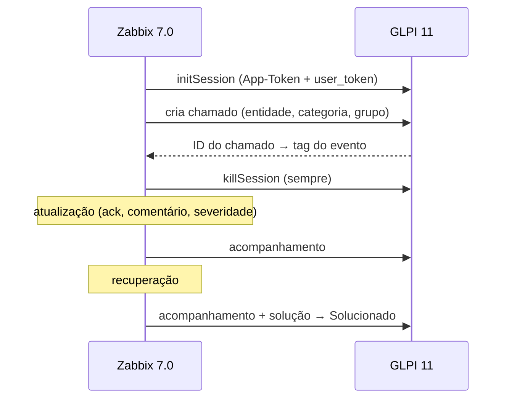

# Integração Zabbix → GLPI

Problemas de severidade **Alta** e **Desastre** no Zabbix abrem chamados no GLPI; a recuperação adiciona um acompanhamento e **soluciona** o mesmo chamado.

## Media type (webhook)

Baseado no media type oficial **GLPI** do Zabbix 7.0, mantido intacto; a versão adaptada é um media type separado. Mudanças:

| Ponto | Oficial | Adaptado |
|---|---|---|
| Entidade / categoria / grupo | não define | definidos por parâmetro |
| Recuperação | só muda o status | acompanhamento + `ITILSolution` (fechamento formal) |
| Atualização | sobrescreve título e urgência | só acompanhamento |
| Sessão da API | nunca encerra | `killSession` sempre, em `finally` |
| Erros | mensagem genérica | HTTP + erro exato do GLPI |
| Logs | registra o session token no debug | sessão sem log |

Urgência: Alta → Alta (4) · Desastre → Muito alta (5). Título: `[Zabbix] {HOST.NAME}: {EVENT.NAME}`.

Tokens do GLPI em **macros globais secretas** (`{$GLPI.APP_TOKEN}`, `{$GLPI.USER_TOKEN}`); nunca em arquivos versionados.

> O framework do media type é código do Zabbix (licença própria); veja o original em `templates/media/glpi` no repositório do Zabbix.

## GLPI

- API REST **legada** (`/apirest.php`) — a API nova (OAuth) fica para migração futura
- Cliente de API restrito ao IP do servidor Zabbix
- Usuário técnico só para a integração; categoria e grupo passados por ID (sem ampliar o perfil de todos os técnicos)

## Zabbix

- **Usuário do robô sem interface e sem API**, com papel do tipo Super admin. Motivo: o Zabbix só alerta quem tem leitura no host, e a sincronização com o NetBox cria grupos novos de primeiro nível — herança de permissão não cobriria.
- **Ação:** severidade ≥ Alta, com *pausar operações de problemas suprimidos*. Sem a condição "não suprimido": um problema que começa numa manutenção e continua depois dela abre chamado ao fim da janela.

## Teste

Host temporário com ping para um IP sem uso → chamado aberto em ~1 min → IP corrigido → chamado solucionado → host removido.
